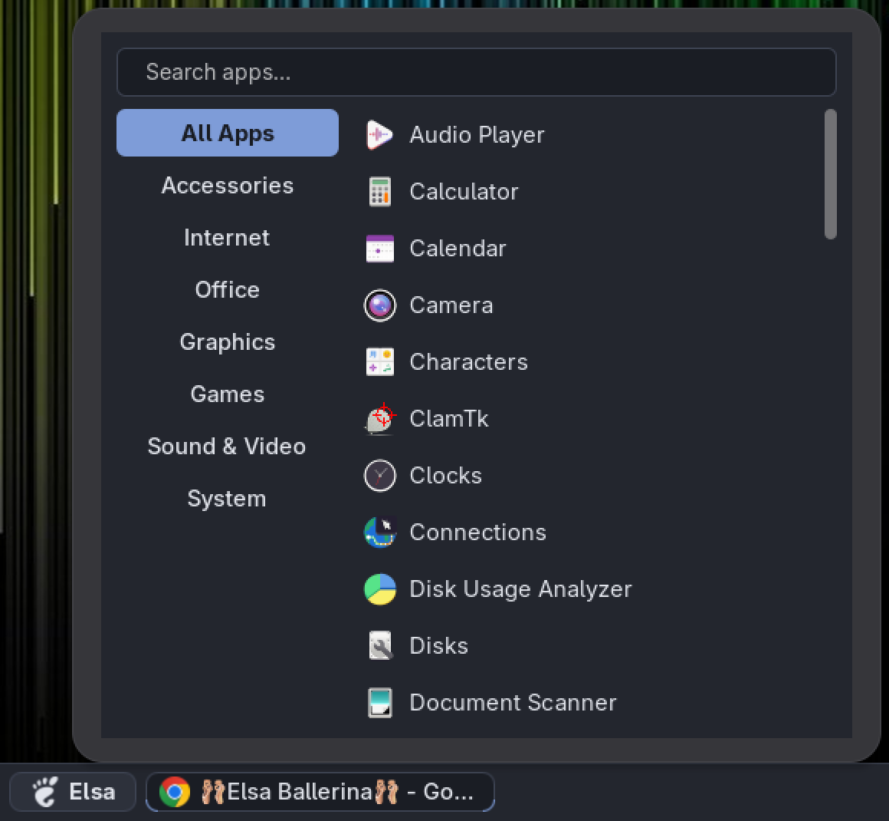
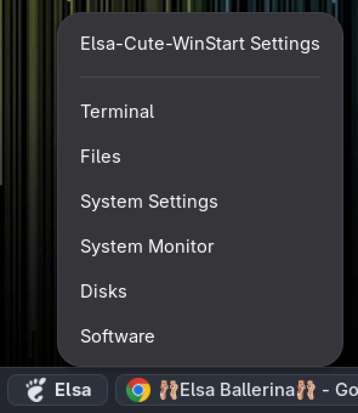
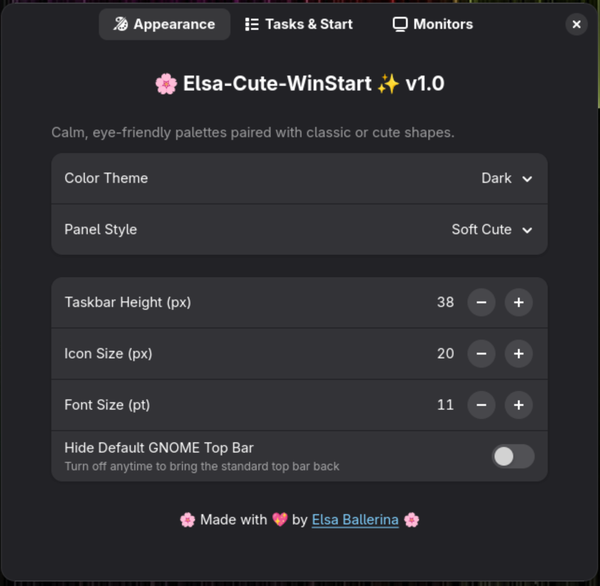
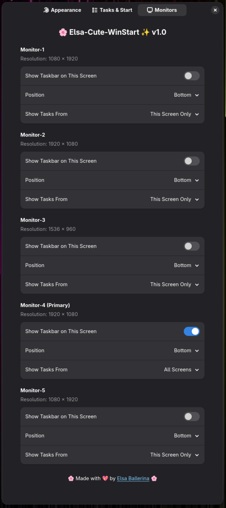

# 🌸 Elsa-Cute-WinStart ✨ 1.0

A cute, calm, Windows 98-inspired multi-monitor taskbar and Start Menu extension for **GNOME Shell** (Fedora Workstation / GNOME 47–51).

Built from scratch to give you rock-solid per-monitor task routing, eye-friendly pastel and classic themes, and a fast, clutter-free Start Menu.

---

## ✨ Features

* **Rock-Solid Multi-Monitor Control:** Anchored to display connector IDs so taskbars stay put when monitors wake or reconnect.
  * Enable/disable the taskbar independently per monitor.
  * Set **Bottom** or **Top** position per monitor.
  * Route tasks per screen: **This Screen Only**, **All Screens**, or **Custom Screen Selection**.
* **5 Calm, Eye-Friendly Themes:** `Light`, `Dark`, `Sakura Pink`, `Pastel Lavender`, and `Mint Cream`.
* **3 Panel Styles:** `Classic 98 Bevel`, `Soft Cute`, and `Compact Minimal`.
* **Flexible Task Modes:** Switch live between **Separate (Classic Win98)**, **Grouped by App**, and **Compact (Icons Only)**.
* **Built-In Start Menu:** Left-click **Start** for categorized apps and instant live search.
* **Super (Win) Key Override:** Optional toggle in settings to open the Start Menu directly with the Super/Win key.
* **Right-Click Start ("Win+X" for Linux):** Quick access to Elsa-Cute-WinStart Settings, Terminal, Files, System Settings, System Monitor, Disks, and Software.
* **System Tray & Clock:** Native GNOME Quick Settings (Sound, Network, Bluetooth, Power) and Calendar integration.

---

## 📦 Easy Installation (End Users)

1. Download `elsa-cute-winstart@elsaballerina.github.io.shell-extension.zip` from the **[Releases](https://github.com/elsaballerina/Elsa-Cute-WinStart/releases)** page.
2. Install it with one command:
   ```bash
   gnome-extensions install elsa-cute-winstart@elsaballerina.github.io.shell-extension.zip
   ```
3. **Log out and log back in** (required on Wayland to load new extensions).
4. Enable it and open Settings:
   ```bash
   gnome-extensions enable elsa-cute-winstart@elsaballerina.github.io
   gnome-extensions prefs elsa-cute-winstart@elsaballerina.github.io
   ```
   *(If user extensions are disabled in GNOME, run `gsettings set org.gnome.shell disable-user-extensions false` first.)*

---

## 🛠️ Manual Install (From Source)

```bash
git clone [https://github.com/elsaballerina/Elsa-Cute-WinStart.git](https://github.com/elsaballerina/Elsa-Cute-WinStart.git)
cd Elsa-Cute-WinStart
chmod +x install.sh
./install.sh
```

---

## 📸 Screenshots

### Start Menu & Right-Click Menu




### Settings




---

## 📄 License

This project is licensed under the MIT License — see the [LICENSE](LICENSE) file for details.

---

<p align="center">
  🌸 Made with 💖 by <a href="https://elsaballerina.github.io">Elsa Ballerina</a> 🌸
</p>
